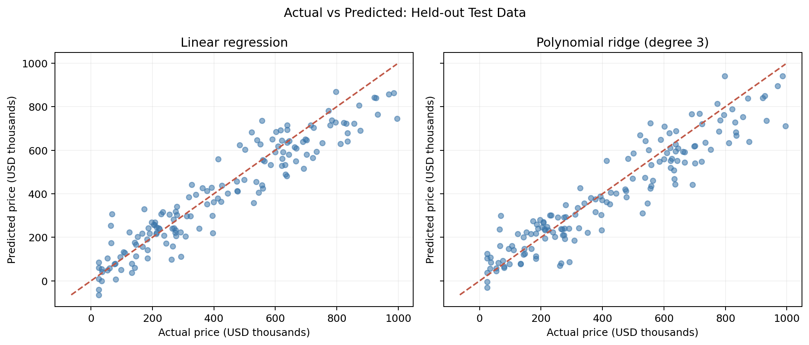

# House Price Prediction: Model Performance and Residual Diagnostics

> **Project status:** Ongoing — reproducible demonstration using **synthetic** housing data. The demonstration must not be represented as a result from a real-world housing market or an earlier class assignment.

## 1. Research question

How accurately can basic housing attributes predict house prices, and what can held-out prediction errors reveal about model limitations? Does a more complex polynomial ridge model generalize better than linear regression?

## 2. Dataset source and usage permissions

This repository uses `data/synthetic_housing.csv`, generated deterministically by `analysis.py` using NumPy (random seed 42). It contains **600 artificial observations** with floor area, bedrooms, building age, distance to a fictitious center, and simulated price. **It does not contain real listings or personal information.** All values were created specifically for this repository by its script; no third-party dataset was copied or downloaded. You may run, reproduce, and adapt the generated example dataset and script; the project author dedicates these materials to the public domain under CC0-1.0 (see `LICENSE`).

**Interpretation warning:** Synthetic results cannot establish patterns, fairness, or accuracy in any actual real-estate market. Before replacing this dataset with a third-party dataset, verify its license and whether redistribution is permitted, and update the data source and limitations here.

## 3. Methods and tools

- **Python**, **NumPy**, **Pandas**, **Matplotlib**, and **scikit-learn**.
- Reproducible 75% training / 25% held-out test split (`random_state=42`).
- Two models: standardized **ordinary least squares regression** and standardized **degree-3 polynomial features + ridge regression** (`alpha=10`).
- Evaluation: train/test R², held-out mean absolute error (MAE), and root mean squared error (RMSE).
- Diagnostic plots: actual vs. predicted price and residual vs. predicted price for both models.

## 4. Key findings and limitation

A verified demonstration run (600 synthetic rows, 150 test rows) produced:

| Model | Train R² | Test R² | Test MAE | Test RMSE |
|---|---:|---:|---:|---:|
| Linear regression | 0.881 | 0.885 | $71,992 | $90,168 |
| Degree-3 polynomial ridge | 0.897 | 0.870 | $75,581 | $95,580 |

*Prices are recorded in thousands of US dollars in the CSV; MAE/RMSE in the table are converted to US dollars.*

**Finding:** In this deliberately constructed example, the more complex polynomial ridge model improves in-sample fit but performs worse on held-out observations. Higher training R² alone is insufficient evidence of better generalization. Diagnostic plots allow further inspection of errors across price levels.

**Limitation:** The housing data and the price-generation mechanism are artificial; findings cannot be generalized to real housing transactions. This toy feature set also lacks location desirability, schools, market timing, and other potentially important predictors.

## 5. Visualizations

### Actual vs. predicted prices


### Residual diagnostics


## 6. How to run

Requires Python 3.10 or newer. From the project root:

```bash
python -m venv .venv
# macOS/Linux: source .venv/bin/activate
# Windows PowerShell: .venv\Scripts\Activate.ps1
python -m pip install -r requirements.txt
python analysis.py
```

Running the analysis regenerates `data/synthetic_housing.csv`, `model_results.csv`, and both PNG plots in `visualizations/`. No external downloads, API keys, or internet access are required.

## 7. Repository safety

Before publishing, make sure there are no secrets, identifying information, privately licensed data, or materials you do not have permission to share. The included `.gitignore` excludes common local environment files, but **does not replace manual review**.

## License

See [LICENSE](LICENSE) (CC0-1.0 dedication) for the author-created demonstration assets.
