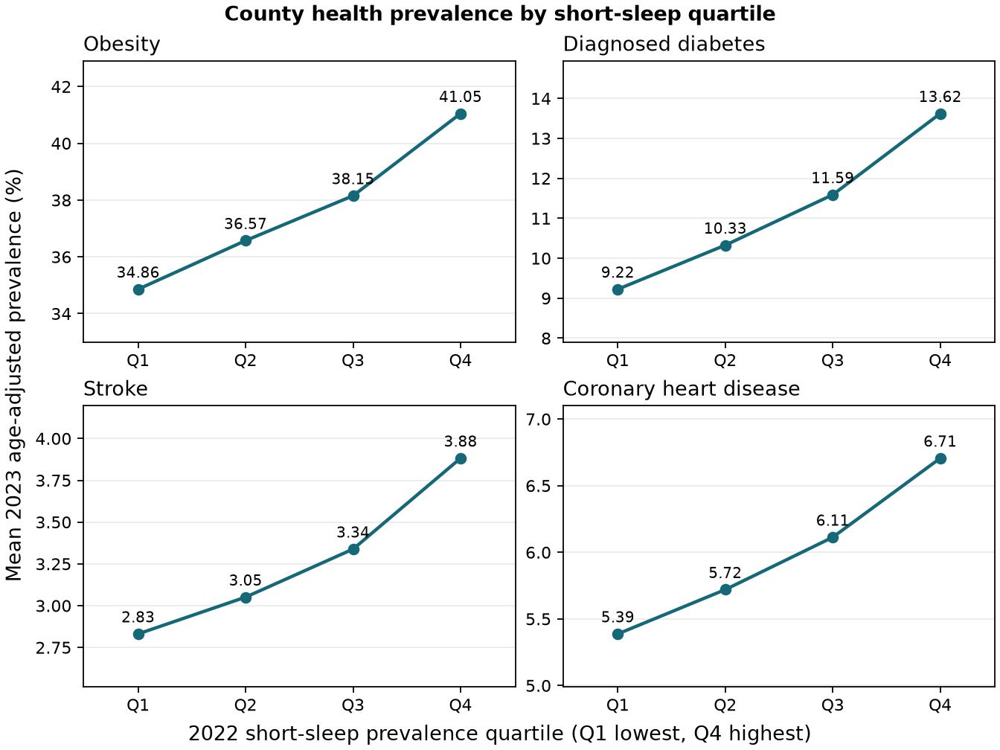
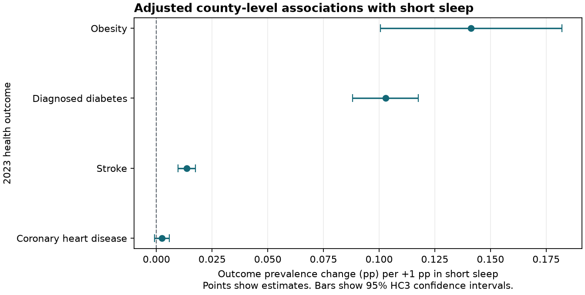

# Short Sleep, Heavier Counties

**Status:** Core analysis reproduced for my personal portfolio. I served as Project Tracker on the original team study, monitoring deliverables, dependencies and risks. This portfolio version reproduces the team's main comparisons and gives reviewers a short path from the data to the charts.

## Research question

Across U.S. counties and county equivalents, is the estimated prevalence of short sleep among adults in 2022 associated with the estimated prevalence of obesity, diagnosed diabetes, stroke and coronary heart disease in 2023? How do these relationships change after accounting for other county characteristics?

## Data source and permissions

The [CDC PLACES county dataset, 2025 release](https://data.cdc.gov/500-Cities-Places/PLACES-Local-Data-for-Better-Health-County-Data-20/swc5-untb/data) lists its license as Public Domain. The [included CSV](data/cdc-places-2025-extract.csv) contains the six fields needed from the CDC export, limited to nine age-adjusted prevalence measures and their study years. All 26,809 records were checked against the corresponding rows in the archived course input. The file contains aggregate county estimates. A county identifier is a geographic code.

## Methods

Read county codes as strings, select 2022 short sleep (under seven hours) and 2023 outcomes and covariates, and retain counties with all model fields. Summarize unweighted mean outcome prevalence across short-sleep quartiles. Fit separate ordinary least squares models for each outcome, adjusting for smoking, physical inactivity, lack of health insurance, depression, log county population and Census region. Report HC3 confidence intervals. Each county has equal weight in these models.

## Findings

The matched sample includes 2,956 counties and county equivalents. Average estimated obesity prevalence was 34.86% in the lowest short-sleep quartile and 41.05% in the highest. All four descriptive outcome means rose across the quartiles. In the adjusted models, each additional percentage point of short-sleep prevalence corresponded to 0.1413 percentage points higher obesity prevalence (95% CI 0.1005 to 0.1820), 0.1029 higher diagnosed diabetes prevalence and 0.0136 higher stroke prevalence. The coronary heart disease estimate was 0.0025 percentage points, with a confidence interval spanning zero (−0.0009 to 0.0059).





## Limitations

The one-year lag orders the county estimates in time. This observational comparison cannot establish causality or individual risk. CDC values are model-based, and missing observations reduce geographic coverage. The team study also found spatially clustered residuals, so the HC3 intervals shown here should be interpreted with caution. The quartile averages describe the counties in this analysis and give large and small counties equal weight.

## Reproduce the analysis

Open this folder from a clone or download of the project repository. The CDC extract ships with the code, so reviewers can run the analysis after installing the dependencies without a separate data download. From this folder, use Python 3.12:

```sh
python -m venv .venv
# macOS or Linux: source .venv/bin/activate
# Windows PowerShell: .venv\Scripts\Activate.ps1
python -m pip install -r requirements.txt
python analysis.py
```

The script writes two figures to `visualizations/` and the corresponding [quartile means](results/quartiles.csv) and [regression estimates](results/adjusted.csv) to `results/`. For a fresh download, use the [CDC API export of the nine age-adjusted measures](https://data.cdc.gov/resource/swc5-untb.csv?$select=year,locationid,stateabbr,measureid,data_value,totalpopulation&$where=datavaluetypeid%3D%27AgeAdjPrv%27%20AND%20measureid%20in%20(%27SLEEP%27,%27OBESITY%27,%27DIABETES%27,%27STROKE%27,%27CHD%27,%27CSMOKING%27,%27LPA%27,%27ACCESS2%27,%27DEPRESSION%27)&$order=locationid,year,measureid&$limit=50000) and pass the CSV path with `python analysis.py --input /path/to/export.csv`. The script selects the study years on input. The included snapshot fixes the source version used for the published results.
